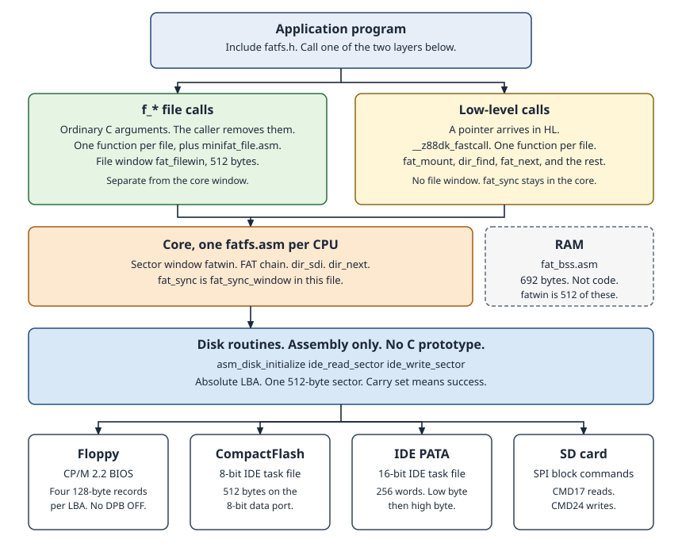

# Mini-FAT

Mini-FAT is the FAT12, FAT16, and FAT32 layer in the classic library. The cores are `libsrc/classic/minifat/z80/fatfs.asm`, `8085/fatfs.asm`, `8080/fatfs.asm`, `gbz80/fatfs.asm`, and `vm1/fatfs.asm`. `fat_sync` stays in the core. `fat_mount`, `dir_find`, `dir_create`, `dir_zap`, `fat_dirty`, `fat_dir_open`, `fat_dir_read`, `fat_next`, `fat_alloc`, `fat_free`, `fat_clst2sect`, `fat_getfree`, and `fat_clusters` are one file each, beside that core. The 8085 file uses `rra` and `rl de` where the Z80 file uses `srl` and `sla`. The labels, the branch decisions, and the bytes a caller sees are the same on every core. vm1 shifts a cluster with an open-coded rotate through A. It has no `rl de`: opcode `$18` is `sub hl,de`. A value already in BC is subtracted with `sub hl,bc`. A value in DE is subtracted with `sub hl,de`, or compared with `cp hl,de`. gbz80 loads an absolute word with `fat_ldhl`. A loop usually reloads the word. The body may store a new value. RAM for the volume and the sector window is `libsrc/classic/minifat/fat_bss.asm`. The C names are `include/fatfs.h`.

The on-disk work follows [ChaN FatFs R0.16](http://elm-chan.org/fsw/ff/00index_e.html) for `check_fs`, `find_volume`, `mount_volume`, `move_window`, `sync_window`, `clst2sect`, `get_fat`, `put_fat`, `create_chain`, `remove_chain`, `dir_sdi`, `dir_next`, `dir_find`, and `dir_create`. The core keeps the sector window, the FAT chain, `dir_sdi`, and `dir_next`. Mount, directory search, directory create, and the C dword calls are separate files in that same directory. The `f_*` file calls are CPU-specific assembly, one function per file, in that directory. They are not part of `fatfs.asm`.

`include/fatfs.h` is the public C header. Link one core and link `fat_bss.asm`, or provide the same public names. A target that wants the objects in its library lists `classic/minifat/minifat.lst` for Z80, or `minifat_8085.lst`, `minifat_8080.lst`, `minifat_gbz80.lst`, or `minifat_vm1.lst`.

## Layers

Mini-FAT has two call layers, one core, and three disk routines. The picture is [minifat-layers.svg](minifat-layers.svg).



An application includes `fatfs.h`. It calls the `f_*` file layer or the low-level calls. Both layers use one core. The core calls `asm_disk_initialize`, `ide_read_sector`, and `ide_write_sector`. Those three routines are the only path to the drive.

The `f_*` calls share `fat_filewin`, a 512-byte file window. That window is separate from `fatwin`. The low-level calls use `fatwin` only. `fat_bss.asm` holds the volume and `fatwin`. It is RAM, not a call.

## Writing a program

Include `fatfs.h`. Link one core: `libsrc/classic/minifat/z80/fatfs.asm`, or the `8085`, `8080`, `gbz80`, or `vm1` file of the same name. Link `libsrc/classic/minifat/fat_bss.asm`. Link each call file the program names, from that same CPU directory.

An `f_*` call also needs `minifat_file.asm` from that directory. A low-level program does not link that file. Each of those asm files includes `minifat.inc` from its own directory. Pass that directory to z80asm with `-Ca-I`.

The objects are not in a classic library until a target lists them. The list names are above. The linker then pulls a call file only when the program uses that name. A file that you pass on the zcc line is linked.

The program also links the three disk routines, or it uses a target that already defines them. `+cpm` uses the BIOS glue in `libsrc/target/cpm/disk/`. `+rc2014` uses the CompactFlash driver. On `+yaz180` the two sector calls are the YABIOS ROM entries `$FE0F` and `$FE3F`.

sccz80 and 80cc accept the calls on each CPU. zsdcc accepts them on Z80. The `f_*` prototypes are `__smallc`, so the caller removes the arguments.

`fat_mount`, `dir_zap`, `fat_sync`, and `fat_dirty` take no arguments and are `__smallc`. A dword call takes a pointer in HL. `fat_dirty` and `fat_clusters` return no status. There is one volume. The core brings up drive 0 only.

## What is in scope

FAT12, FAT16, and FAT32. 512-byte sectors. One volume. Short 8.3 names. One or two FAT copies. A super-floppy whose boot sector is at LBA 0, or an MBR with four primary partitions. The first sector that looks like a FAT boot sector is the volume. FAT12 uses the FAT16 root shape: a non-zero root entry count and `FATSz16`.

The partition type byte is not read. The sector window is `fatwin`, 512 bytes. Every FAT entry and every directory entry is read through that window. A dirty window is written back before a different sector is loaded. `fat_sync` writes it when you are finished.

A cluster number and an LBA are a 32-bit value in BCDE, with E as the low byte. From C, the dword functions take a pointer in HL (`__z88dk_fastcall`) and load that little-endian dword themselves.

Success is `L = 0` and carry set. Failure is `L = 1` and carry clear. A 64 KiB cluster is the exception: `L = 19` (`FR_INVALID_PARAMETER`) and carry clear. `fat_mount` reports a bad volume as `L = 13` (`FR_NO_FILESYSTEM`), a sector read that failed as `L = 1`, and a drive that did not come ready as `L = 3`. `f_mount` returns that same code. A later `f_*` call that has to mount the volume returns that same code. sccz80 widens that byte to an int, so H is 0. 80cc and zsdcc return the byte in L. Test L, or test carry.

## File calls

The file calls open a file, seek, read, write, and close it. Each call is CPU-specific assembly, one function per file, beside that CPU's core. The calls share one file-sector window, separate from `fatwin`. The core still stops before those calls, so you can walk the cluster chain and read the sectors yourself. Find, label, forward, `f_mkfs`, `f_fdisk`, `f_setcp`, and the string helpers are outside this library. `f_eof`, `f_tell`, `f_size`, `f_error`, and `f_rewind` are macros in `fatfs.h`.

Also out of scope for the core: exFAT, long file names, GPT, extended partitions, and a current directory stack. `BPB_Media` is not read. FAT entry 0 is not compared with `BPB_Media`. The jump instruction at the start of the boot sector is not required. The `55 AA` signature is required. ChaN accepts some boot sectors that have no signature. This code does not. There is no `ffconf.h` and no option set.

`dir_next` does not grow a directory. `dir_create` grows a FAT32 directory when the chain is already at its end. A FAT16 root and a FAT16 subdirectory stay the size they were formatted.

## Using the f_* calls

`FRESULT` is the low byte of HL. Zero is `FR_OK`. `f_eof`, `f_error`, `f_tell`, `f_size`, and `f_rewind` are macros. `f_truncate` is not in this library. Find, label, forward, `f_mkfs`, `f_fdisk`, and `f_setcp` stay out.

`f_mount` takes a `FATFS`, a path, and `opt`. `"0:"` selects the volume. A path with no drive prefix selects it too. A null path selects it too. `"1:"` through `"9:"` return `FR_INVALID_DRIVE`.

`opt` of 0 registers the object and does not read the disk. Any other `opt` mounts. A null `FATFS` clears the volume. Close each open file first. The mount discards a dirty file cache.

`f_open` takes a `FIL`, a path, and a mode. `FA_READ` opens an existing file. `FA_WRITE` opens it for write and refuses a read-only file. `FA_CREATE_NEW` creates a file and returns `FR_EXIST` when the name is already there.

`FA_CREATE_ALWAYS` creates a file or truncates the old one. `FA_OPEN_ALWAYS` opens a file or creates one. `FA_OPEN_APPEND` does that open and then seeks to the end. An error leaves the object id at 0.

`FA_OPEN_EXISTING` is 0. It opens a file that is already there. A missing name returns `FR_NO_FILE`. That mode has no `FA_READ` bit. A following `f_read` returns `FR_DENIED`.

`f_read` writes 0 to the byte count, then copies the bytes that remain in the file. The mode must include `FA_READ`.

`f_write` writes 0 to its byte count. The mode must include `FA_WRITE`. The call clips a write that would pass `$FFFFFFFF`. The count is 16 bits, so that happens only when the high word of the file pointer is `$FFFF`. A short write at the end of the disk returns `FR_OK`. The call marks the file modified even when the count is 0.

`f_lseek` moves the file pointer. A read seek stops at the file size. A write seek grows the chain up to that offset. When the disk is full, the call returns `FR_OK` and leaves the pointer at the size reached. `f_sync` writes the directory entry when the file is modified, then writes the core window. `f_close` syncs the file and drops the object only when that sync returns `FR_OK`.

`f_opendir` opens a directory. A missing path returns `FR_NO_PATH`. A file returns `FR_NO_PATH`. `"."` and the root are that directory.

`f_readdir` skips a deleted slot, a dot name, a long name, and a label. The end of the directory is `FR_OK` and an empty name. A null `FILINFO` rewinds the directory. `f_closedir` drops the object.

`f_mkdir` creates a directory and writes `"."` and `".."`. Create, write, close, and sync do not write a time or a date. `f_utime` is the only call that stores one. `f_unlink` rejects a dot name, a read-only object, and the current directory. A directory must contain only `"."` and `".."`. The call deletes the entry and frees the chain.

`f_rename` registers the new name and copies the old entry onto it. It updates `".."` when a directory changes parent. It then deletes the old name. A directory may be moved into its own descendant. FatFs R0.16 does the same.

`f_stat` fills a `FILINFO` from the entry. `f_chmod` changes the read-only, hidden, system, and archive bits that the mask selects. Directory and volume bits stay. `f_utime` stores the stamp from the `FILINFO`. A date of zero leaves the old stamp.

`f_chdir` stores the cluster and the path text. A file returns `FR_NO_PATH`. `f_getcwd` copies that text. The length counts the NUL. `f_chdrive` accepts `"0:"` and a path with no prefix. This library has one volume.

`f_getfree` writes the free cluster count.

`f_expand` finds one contiguous run for the file. The search starts at cluster 2 and does not wrap. `opt` 0 stores one less than the start cluster in the allocation hint. It does not change the file's start cluster or size. `opt` 1 links the run. `opt` above 1 returns `FR_INVALID_PARAMETER`. The call does not write the directory entry.

An assembly caller places the last C argument at `sp+2`. The header of each file gives that order. A C program leaves the stack to the compiler.

## Examples

Both fragments need the disk routines at link time. Test the result against 0. `FR_OK` is 0, and a low-level success is 0 in L.

The file layer mounts, opens, reads, and closes. The path uses a dot. The mode is `FA_READ`.

```c
#include <fatfs.h>

void read_note(void)
{
    FATFS vol;
    FIL file;
    UINT n;
    char buf[32];

    if (f_mount(&vol, "0:", 1) != FR_OK)
        return;
    if (f_open(&file, "NOTE.TXT", FA_READ) != FR_OK)
        return;
    if (f_read(&file, buf, sizeof buf, &n) != FR_OK)
        return;
    f_close(&file);
}
```

`fat_mount` takes no argument. `dir_find`, `fat_dir_open`, `fat_clst2sect`, and `fat_next` take a pointer in HL. The 11-byte name is eight characters, then the extension, with spaces and no dot. `fat_clst2sect` replaces the cluster with the first LBA. `fat_next` replaces it with the next cluster, or `$0FFFFFFF` at the end of the chain.

Copy the cluster before either call if you still need it. `ide_read_sector` then reads that LBA. It has no C prototype.

```c
#include <fatfs.h>

static uint8_t note_name[] = "NOTE    TXT";

void find_note(void)
{
    uint32_t clst;
    uint32_t next;

    if (fat_mount() != 0)
        return;
    clst = 0;
    if (fat_dir_open(&clst) != 0)
        return;
    if (dir_find(note_name) != 0)
        return;
    clst = fat_found_sclust;
    next = clst;
    if (fat_clst2sect(&clst) != 0)
        return;
    if (fat_next(&next) != 0)
        return;
    fat_sync();
}
```

## Calling it from your own program

Link one core. Link `fat_bss.asm`, or provide the same public names yourself. The block may be placed at `FAT_BSS_ORG`. A program that runs where it was linked can leave the block in ordinary BSS. A program that calls `fat_mount`, `dir_find`, or another C name in `fatfs.h` links that function's file from the same CPU directory. A program that calls an `f_*` name links that file too. The list file names each call, and the linker pulls a call in only when the program uses it.

You supply the disk. The core calls three assembly routines. They have no C prototype and they do not follow the C ABI. A C program does not call them.

`asm_disk_initialize`

- In: `L = 0`. That is the only drive the core brings up.
- Out: carry set means the drive is ready. Carry clear means it is not.
- The core tests carry only. It does not read a status byte from HL.
- The core keeps BC across the call. The other registers may change.

`ide_read_sector`

- In: `BCDE` is the absolute LBA, E the least significant byte. `HL` is the destination, 512 bytes.
- Out: carry set means those 512 bytes were stored and `HL` is `HL + 512`. Carry clear means the sector was not read.
- Clobbers AF, BC, DE, and HL.

`ide_write_sector`

- In: `BCDE` is the LBA, E least significant. `HL` is the source, 512 bytes.
- Out: carry set means the sector was written and `HL` is `HL + 512`. Carry clear means it was not written.
- Clobbers AF, BC, DE, and HL.

One sector per call. The LBA is the absolute sector on that drive. The core saves the LBA across the call. These are not ChaN `disk_read` and `disk_write`.

Then:

1. Call `fat_mount` (C: `fat_mount()`). On success `_cpm_fat_vol` describes the volume. `fs_type` is stored only after every check has passed, so a failed mount leaves it zero.
2. Open a directory with `fat_dir_open`. Cluster 0 is the FAT32 root. A FAT16 root is the fixed `dirbase` LBA, and the shell treats cluster 0 as that root as well.
3. `dir_find` looks up an 11-byte name in the directory you opened. `fat_dir_read` copies one 32-byte entry and returns 0. The next call returns 1 when that entry starts with `$00`. The end path writes 0 into the first byte of the buffer and returns 1. A sector that cannot be read returns 1 and leaves the buffer unchanged. A buffer that already starts with 0 does not show which of those two happened. The `f_*` layer does not use this call.
4. To read a file, take its start cluster and size from the entry (`fat_found_sclust`, `fat_found_size` after a successful find). `fat_next` is `get_fat`. `fat_clst2sect` is the first sector of that cluster. Read `csize` sectors, then ask for the next cluster. The end of a FAT12 chain is `$FF8`–`$FFF`, folded to `$0FFFFFFF`. The end of a FAT16 chain is `$FFF8`–`$FFFF`. The end of a FAT32 chain is `$0FFFFFF8` and up. A bad cluster (`$FF7` / `$FFF7` / `$0FFFFFF7`) is an error, not a link. A file offset uses a 16-bit cluster index. An index past 65535, or past `n_fatent`, is rejected. A chain that loops inside that range is not detected. `remove_chain` stops when the step count reaches `n_fatent`.
5. To write a new file, `dir_create` makes an 8.3 entry, `fat_alloc` / `create_chain` links clusters, you write the sectors, you store the size back into the directory entry, and `fat_sync` commits the window. `dir_zap` marks the entry `$E5`. It does not free the chain. Call `fat_free` yourself.
6. `fat_getfree` counts free clusters into the dword you point at. `fat_clusters` turns a byte length into the number of clusters that length needs.

The directory entry layout is Microsoft's. Byte 0 is the name. `$00` ends the directory. `$E5` is a deleted slot and can be reused. A real name that begins with `$E5` is stored as `$05`, and a compare treats `$05` as `$E5`. An 8.3 name may use digits, letters, and `_ - ! # $ % &`. A lower-case letter is folded. Other bytes are rejected. Attribute `$0F` is a long name. Attribute `$08` is a label and `$10` is a directory. The volume bit is set on a long name, so a test of that bit skips both labels and long names. The archive bit is `$20`.

Specification 1.03 also allows a space, an apostrophe, @, a tilde, a grave, parentheses, and braces. This code rejects those marks. A space pads an 8.3 name in the specification.

`n_fatent` is the cluster count plus 2. Cluster numbers below 2 are not data. `csize` is a power of two. `SecPerClus` of 65 or more is refused, because a 64 KiB cluster is 0 in the 16-bit sector arithmetic.

Microsoft FAT specification 1.03 also allows a sector of 1024, 2048, or 4096 bytes. This code accepts a sector of 512 bytes only.

Two boundaries follow ChaN rather than Microsoft FAT specification 1.03. A cluster count of `$0FF5` or below is FAT12. The specification would still call 4085 clusters FAT16. A count of `$FFF5` stays FAT16. The specification would call that FAT32. A count above `$FFF5` is FAT32 and is accepted up to `$0FFFFFF5`. A count above `$0FFFFFF5` is rejected. `put_fat` writes the low 28 bits of a FAT32 entry and leaves bits 28 to 31 unchanged. On FAT12, `put_fat` writes 12 bits. A FAT of `$200000` sectors or more is rejected before the copies are added.

A FAT12 entry is 12 bits packed as `clst + clst/2` bytes from the start of the FAT. An even cluster owns the low 12 bits. An odd cluster owns the high 12 bits. The two bytes can sit in different sectors. The size of the FAT is `(n_fatent * 3 + 1) / 2` bytes, rounded up to sectors. A free count on FAT12 walks clusters 2 through `n_fatent - 1`. Clusters 0 and 1 are reserved.

The IDE address is 28 bits. A partition, FAT, or data area at LBA `$10000000` or above fails the mount. An FSInfo sector past that LBA leaves the hint clear and the mount still succeeds. `$0FFFFFFF` is the last sector the interface can name.

A FAT16 root entry count has to be a non-zero multiple of 16. Every directory stops at 2048 entries, because the directory offset is 16 bits. FAT32 requires `FATSz16 = 0`, `FSVer = 0`, and a root entry count of 0. The root cluster is `BPB_RootClus`. A root cluster below 2, or at or above `n_fatent`, is rejected. When mirroring is off, the active FAT is the one in `BPB_ExtFlags`, and the other copy is not written. FAT32 FSInfo is read at mount. A sync writes the free count and the next free cluster when either has changed.

## Disk drivers

The core calls three assembly names. They have no C prototype. The registers are under [Calling it from your own program](#calling-it-from-your-own-program). There is one drive. The LBA is the absolute sector on that drive. One call moves 512 bytes.

Set carry when the transfer worked, and add 512 to HL. Clear carry when it did not. The driver may change AF, BC, DE, and HL. The core saves BC across `asm_disk_initialize`. It also saves the LBA across a sector call.

`+rc2014` and `+yaz180` already publish these names. A second definition makes the link fail. A new board supplies its own three routines.

### Floppy

`libsrc/target/cpm/disk/` is the CP/M 2.2 driver. The source uses 8080 opcodes, so these files build for every classic CP/M CPU. Take the BIOS offsets from the WBOOT jump at address 1. A 512-byte LBA is four 128-byte records. The LBA is already a physical sector.

1. When L is 0, call SELDSK at offset 24 with C = 0 and E = 0.
2. When the DPH is 0, return with carry clear.
3. When L is not 0, return with carry clear.
4. Shift the LBA left by two bits to form the first record number.
5. When that shift carries out of B, return with carry clear.
6. Read SPT from the DPB and divide the record number by SPT.
7. Use the quotient as the track and the remainder as the sector.
8. Do not add the DPB OFF field.
9. When the DPH translation word is not zero, call SECTRAN.
10. When that word is zero, call SETSEC with the sector as it stands.
11. Call SETDMA with the buffer.
12. Call READ, or call WRITE with C = 1 so the BIOS finishes the sector.
13. When A is not 0, return with carry clear.
14. Add 128 to the buffer.
15. When four records are done, set carry and return with HL 512 bytes higher.
16. Do not step the sector after that last record.
17. When a record remains, step the sector.
18. When the sector equals SPT, set it to 0 and step the track.
19. When that track step wraps past 65535, return with carry clear.
20. Repeat from the SETDMA call.

Every 512-byte transfer starts with SELDSK, C = 0 and E = 1, and reads the DPH again. Step 1 is only the bring-up select.

### CompactFlash

`libsrc/target/rc2014/driver/ide/` is the 8-bit driver. `__IO_CF_8_BIT` selects that path. `+rc2014` already publishes the three names. Each IDE word is two reads of the 8-bit data port. `ide_init` can wait forever when no card is fitted.

1. When L is not 0, return with carry clear.
2. Hard-reset the card.
3. Soft-reset the card.
4. Call the init.
5. Set carry only when all three return ready.
6. Wait until the drive is ready.
7. Write E to LBA0, D to LBA1, and C to LBA2.
8. Write `$E0` combined with the low four bits of B to LBA3.
9. That byte selects the master drive and LBA mode.
10. Write a sector count of 1.
11. Write command `$20` to read, or `$30` to write.
12. Wait for DRQ.
13. Move 512 bytes through the 8-bit data port.
14. Set carry and leave HL 512 bytes higher.
15. On a fault, clear carry.

### IDE PATA

The task file matches CompactFlash. The data register is 16 bits. One sector is 256 words. Store the low byte, then the high byte.

`libsrc/target/yaz180/driver/ppide/` drives that register through the 8255. The word transfer is `ide_read_block` in `libsrc/target/yaz180/device/8255/8255_ide_read_block.asm`.

On `+yaz180`, `ide_read_sector` is ROM entry `$FE0F` and `ide_write_sector` is `$FE3F`. Do not define those names in the application. `asm_disk_initialize` remains the library routine.

The same RC2014 source has a 16-bit path. The build uses it when `__IO_CF_8_BIT` is 0.

### SD card

`libsrc/classic/sdcard/` is a different contract. `sd_initialize`, `sd_read_sector`, and `sd_write_sector` are C calls. A is 0 when the card accepts the command. Mini-FAT does not call those names.

Publish the three assembly names in the driver. Call the sdcard routines from that driver when you want their SPI code.

1. When L is 0, initialise the SPI slot.
2. Read the status from `sd_initialize` in A and HL. That call does not use carry.
3. Set carry only when the status says the card is ready.
4. Send CMD17 (`$51`) to read one block.
5. Send CMD24 (`$58`) to write one block.
6. On an SDHC card, pass the LBA as the argument.
7. On a card of 2 GB or less, pass the LBA shifted left by 9.
8. `sd_set_sector_addr_regs` does that shift when carry is set and the card is not SDHC.
9. On a read, wait for the data token and store 512 bytes.
10. Then read the two CRC bytes.
11. On a write, send token `$FE`, then the 512 bytes, then the CRC.
12. Set carry only when the card accepts the transfer.
13. Add 512 to HL on that path.

## Size

`z88dk-z80nm` printed the `code_lib` size of each object from `make -C libsrc classic-minifat`. The unit is bytes. RAM is the `bss_compiler` section. The linker pulls a call file only when the program uses that name. Each total below adds every file in that group.

The core is one object. A call that uses the core links all of the core bytes. `fat_sync` has no file of its own. An `f_*` program also links `minifat_file.asm`. That row is not inside the `f_*` total.

| Part | Z80 | 8085 | 8080 | gbz80 | vm1 |
| --- | ---: | ---: | ---: | ---: | ---: |
| Core `fatfs.asm`, with `fat_sync` | 2540 | 2740 | 2819 | 3118 | 2771 |
| Low-level calls, 13 files | 2533 | 2700 | 2777 | 3025 | 2734 |
| `f_*` calls, 21 files | 3649 | 3734 | 3990 | 4574 | 3917 |
| File layer `minifat_file.asm` | 2727 | 2939 | 3035 | 3234 | 2953 |

| RAM | Bytes | When it is linked |
| --- | ---: | --- |
| `fat_bss.asm` | 692 | With the core. 512 bytes are `fatwin`. |
| File-layer BSS | 674 | With any `f_*` call. 512 bytes are `fat_filewin`. |
| `f_rename` BSS | 47 | With `f_rename` only. |

The RAM figures are the same on each CPU.

Low-level call files:

| Call | Z80 | 8085 | 8080 | gbz80 | vm1 |
| --- | ---: | ---: | ---: | ---: | ---: |
| `fat_mount` | 1367 | 1490 | 1503 | 1641 | 1490 |
| `dir_find` | 178 | 172 | 193 | 215 | 183 |
| `dir_create` | 300 | 333 | 361 | 370 | 351 |
| `dir_zap` | 15 | 15 | 15 | 17 | 15 |
| `fat_dirty` | 6 | 6 | 6 | 6 | 6 |
| `fat_dir_open` | 15 | 15 | 15 | 15 | 15 |
| `fat_dir_read` | 44 | 48 | 48 | 49 | 48 |
| `fat_next` | 53 | 63 | 63 | 65 | 63 |
| `fat_alloc` | 21 | 22 | 22 | 21 | 22 |
| `fat_free` | 12 | 12 | 12 | 12 | 12 |
| `fat_clst2sect` | 21 | 22 | 22 | 21 | 22 |
| `fat_getfree` | 382 | 388 | 398 | 482 | 388 |
| `fat_clusters` | 119 | 114 | 119 | 111 | 119 |

`f_*` call files:

| Call | Z80 | 8085 | 8080 | gbz80 | vm1 |
| --- | ---: | ---: | ---: | ---: | ---: |
| `f_mount` | 108 | 105 | 114 | 128 | 114 |
| `f_open` | 344 | 353 | 368 | 370 | 368 |
| `f_close` | 31 | 25 | 32 | 38 | 32 |
| `f_read` | 77 | 67 | 83 | 104 | 83 |
| `f_write` | 124 | 122 | 144 | 172 | 130 |
| `f_lseek` | 373 | 376 | 403 | 458 | 393 |
| `f_sync` | 19 | 13 | 20 | 24 | 20 |
| `f_opendir` | 160 | 167 | 177 | 225 | 177 |
| `f_closedir` | 54 | 58 | 65 | 71 | 58 |
| `f_readdir` | 291 | 290 | 310 | 334 | 303 |
| `f_mkdir` | 300 | 318 | 327 | 380 | 327 |
| `f_unlink` | 205 | 229 | 236 | 263 | 236 |
| `f_rename` | 349 | 389 | 409 | 509 | 374 |
| `f_stat` | 72 | 70 | 79 | 88 | 79 |
| `f_chmod` | 87 | 82 | 89 | 95 | 89 |
| `f_utime` | 107 | 101 | 112 | 127 | 112 |
| `f_chdir` | 74 | 72 | 78 | 90 | 78 |
| `f_chdrive` | 20 | 15 | 20 | 21 | 20 |
| `f_getcwd` | 86 | 87 | 96 | 114 | 96 |
| `f_getfree` | 82 | 77 | 89 | 110 | 89 |
| `f_expand` | 686 | 718 | 739 | 853 | 739 |

## The volume block

`fat_vol_t` in `fatfs.h` is the block at `_cpm_fat_vol`:

| Field | Meaning |
|--|--|
| `fs_type` | 0 until mount succeeds, then 1 = FAT12, 2 = FAT16, 3 = FAT32 |
| `csize` | sectors per cluster |
| `n_rootent` | FAT12 and FAT16 root entries, 0 on FAT32 |
| `n_fatent` | clusters plus 2 |
| `fatbase` | LBA of the FAT |
| `dirbase` | FAT16 root LBA, or the FAT32 root cluster |
| `database` | LBA of cluster 2 |
| `fatsz` | sectors in one FAT |
| `n_fats` | 1 or 2 |
| `free_valid` | 1 when `free_clst` is live |
| `free_clst` | free clusters |

`_cpm_dir_sclust` is sixteen dwords. This library does not read them. A later shell may store one start cluster per drive letter. Zero means that letter is not mounted.

## On the RC2014

This library does not include the RC2014 boot or the BDOS. A later target may keep mini-FAT in ROM. The boot must not call mini-FAT while RAM covers that ROM window.

A later BDOS may use `fatwin` as the function 27 buffer. That routine must invalidate the window before it returns. The next disk call loads a real sector again.

A file does not have to be contiguous.
